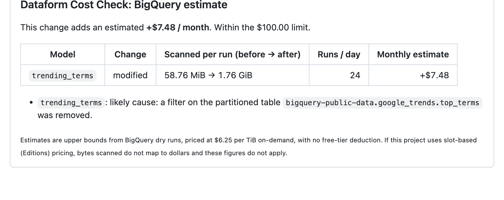

# Dataform Cost Check

[](https://github.com/marketplace/actions/dataform-cost-check)
[](https://scorecard.dev/viewer/?uri=github.com/cadamsmith/dataform-cost-check)

A BigQuery cost estimate on every [Dataform](https://cloud.google.com/dataform) pull request:
a price tag on every data change, before it ships rather than on next month's bill.

[](https://github.com/cadamsmith/dataform-cost-check/pull/22)

<sub>A real comment, rendered by GitHub. [`examples/trends-demo`](examples/trends-demo) posted it to [pull request #22](https://github.com/cadamsmith/dataform-cost-check/pull/22): a two-commit Dataform project over Google's public Trends dataset, whose second commit drops a date filter.</sub>

- **Runs in your CI, against your Google Cloud project.** No service of ours, no account, no
  telemetry. Your compiled SQL goes only to BigQuery, in the project you choose.
- **Free and read-only.** BigQuery dry runs plan each query and report the bytes it would
  scan, without reading data or billing anything. No write access, no keys: it signs in through
  Workload Identity Federation.
- **Reads the compiled project**, so `.sqlx` files and JavaScript-defined actions
  (`publish()` loops, `includes/` helpers) are estimated the same way.
- **Names the usual culprit**, a dropped partition filter, and can fail the check above your
  monthly limit.

**Get started: [Try it on your project](docs/getting-started.md)**, about 15 minutes, most of
it in Google Cloud.

> **Status: alpha (0.4.4).** It runs end to end in GitHub Actions with keyless sign-in to
> Google Cloud, tested on a private Dataform 3 project with JavaScript-defined actions. Try it
> on a non-critical repository first, and tell us what it gets wrong. Using it? Say so in
> [this discussion](https://github.com/cadamsmith/dataform-cost-check/discussions/92).

## Why

In Dataform, a one-line change to a query can change what it scans by orders of magnitude.
Drop a date filter on a partitioned table and a few MiB per run can become hundreds of GiB,
run every hour. Code review shows the SQL diff, not the bytes, so the first sign is often the
bill. dbt users already have cost checks; Dataform had no packaged pull request check. This
puts the estimate where the change is reviewed.

It is for teams on BigQuery who manage transformations with Dataform and review changes on
GitHub.

## How it works

When a pull request opens, the action compiles the Dataform project at the base and head
commits, finds the models whose compiled SQL changed, asks BigQuery for a free dry-run byte
count for each, and posts one sticky comment. A fuller example, with every section:

<!-- BEGIN GENERATED: sample comment (pnpm readme) -->
<!-- prettier-ignore-start -->
> ### Dataform Cost Check: BigQuery estimate
>
> This change adds an estimated **+$246.97 / month**. :x: Over the $100.00 limit.
>
> | Model | Change | Scanned per run (before → after) | Runs | Monthly estimate |
> |---|---|---|--:|--:|
> | `orders_daily` | modified | 40.96 GiB → 1.24 TiB | 1 / day | +$225.00 |
> | `customers` | added | 0 B → 5.00 GiB | 24 / day | +$21.97 |
>
> - `orders_daily`: likely cause: a filter on the partitioned table `proj.raw.orders` was removed.
>
> **Not estimated**
>
> - `orders_v` (modified): Views cost nothing to create; the cost lands on whatever reads them.
>
> <sub>Estimates are upper bounds from BigQuery dry runs, priced at $6.25 per TiB on-demand, with no free-tier deduction. Runs per day come from `dataform-cost-check.yml`, not from your schedules. If this project uses slot-based (Editions) pricing, bytes scanned do not map to dollars and these figures do not apply.</sub>
<!-- prettier-ignore-end -->
<!-- END GENERATED -->

## What it does

- Sticky pull request comment with the total monthly estimate change (none on pull requests
  that change no models)
- Bytes scanned before and after, per changed model
- When incremental models change: what one full refresh of the changed models would read,
  before and after, for teams that rebuild from scratch. Kept out of the monthly figure
- Flags the most common cause of a jump: a lost partition filter
- One configurable spending limit that can fail the check
- Last refresh duration (and slot-hours, for slot-based pricing) per table, shown as history
  when you opt in by granting job-listing access. Never a billed query, never a forecast.
- Says plainly what it did not estimate, and why: a read of a table the same pull request
  creates, a filter on a variable or a read of a temp table set up in pre-operations, a view (it costs nothing until read)

## Usage

**New here? Follow [Try it on your project](docs/getting-started.md)**: Google Cloud setup,
the workflow and the config, step by step, with troubleshooting.

```yaml
# .github/workflows/cost-check.yml
on: pull_request # never pull_request_target

# A newer push cancels the older run, so it can't overwrite the newer estimate.
concurrency:
  group: dataform-cost-check-${{ github.event.pull_request.number }}
  cancel-in-progress: true

jobs:
  estimate:
    runs-on: ubuntu-latest
    permissions:
      contents: read
      pull-requests: write
      id-token: write # keyless auth to Google Cloud
    steps:
      - uses: actions/checkout@v5
        with:
          fetch-depth: 0
      - uses: google-github-actions/auth@v3
        with:
          workload_identity_provider: projects/PROJECT_NUMBER/locations/global/workloadIdentityPools/POOL_ID/providers/PROVIDER_ID
          service_account: dataform-cost-check@PROJECT_ID.iam.gserviceaccount.com
      - run: npm install -g @dataform/cli
      # Only if the project has a package.json (pins @dataform/core):
      # - run: npm ci
      # Pin the full commit SHA of a release, not a tag (see SECURITY.md).
      - uses: cadamsmith/dataform-cost-check@<commit SHA> # v0.4.4
        with:
          config-path: dataform-cost-check.yml
```

| Input              | Default                       | Description                                       |
| ------------------ | ----------------------------- | ------------------------------------------------- |
| `config-path`      | `dataform-cost-check.yml`     | Path to the config file                           |
| `project-dir`      | `.`                           | Directory of the Dataform project                 |
| `project-id`       | the authenticated project     | Google Cloud project for dry runs                 |
| `base-ref`         | the pull request's base SHA   | Commit to compare against                         |
| `default-database` | from `workflow_settings.yaml` | Compile as production: overrides `defaultProject` |
| `default-schema`   | from `workflow_settings.yaml` | Overrides `defaultDataset`                        |
| `default-location` | from `workflow_settings.yaml` | Overrides `defaultLocation`                       |
| `schema-suffix`    | none                          | Release config's schema suffix                    |
| `table-prefix`     | none                          | Release config's table prefix                     |
| `vars`             | none                          | Compilation variables, `key=value,key2=value2`    |
| `github-token`     | `${{ github.token }}`         | Token used to post the sticky comment             |

**Compile as production.** If production runs from a release config with compilation
overrides (another project, a schema suffix, variables), set the same values in the inputs
above. Otherwise the check compiles your development settings, and dry runs may read
datasets that do not exist or use the wrong variable values. Models keep the names
written in the project, so `runs_per_day` entries match with or without a table prefix.

Configuration, in `dataform-cost-check.yml` (see [`dataform-cost-check.example.yml`](dataform-cost-check.example.yml)).
Without the file, every model is assumed to run once a day, no limit applies, and the comment
says so. A `config-path` other than the default must point to a file that exists, or the check
fails:

```yaml
# price_per_tib: 6.25 # optional: one USD price everywhere (default: Google's list price per location)
# price_per_tib_by_location: # optional: your own price for some locations
#   asia-northeast1: 7.00
limit_monthly: 100 # fail the check above this
default_runs_per_day: 1 # weekly: 0.142857 (1/7)
runs_per_day: # overrides by model name, or by a tag your schedules select on
  hourly: 24
history: false # opt-in: last run per changed model, see Permissions
```

## Permissions

The action needs a Google Cloud service account that it signs in as without a key,
through Workload Identity Federation. Grant it only:

| Role                                               | Where                                          | Why                                                                                             |
| -------------------------------------------------- | ---------------------------------------------- | ----------------------------------------------------------------------------------------------- |
| BigQuery Job User (`roles/bigquery.jobUser`)       | The project the dry runs run in (`project-id`) | `bigquery.jobs.create`, to start dry-run jobs                                                   |
| BigQuery Data Viewer (`roles/bigquery.dataViewer`) | Each dataset your models read (or the project) | BigQuery checks read access on every table a dry run references, as it would for the real query |

**Optional, for refresh history** (`history: true` in the config): BigQuery Resource Viewer
(`roles/bigquery.resourceViewer`) on the `project-id` project, for `bigquery.jobs.listAll`.
History is read from that project's job records, so it shows runs only when Dataform runs
its jobs there too. The role lets the account list everyone's jobs in the project, SQL
included (matched in memory, never posted); grant it only if you want history. The action then reads the free job records (`jobs.list`) and shows
each changed model's last run: when, how long, and slot-hours, which is what slot-based
(Editions) pricing charges for. It is history, never a forecast. Without the role, the
comment says history is unavailable and the check carries on.

A dry run is free and reads no data: BigQuery only plans the query and reports the bytes it
would scan. The action never runs a billable query and needs no write access. Data Viewer also covers the table metadata the action reads to tell which tables are
partitioned, which it uses to name a lost partition filter.

Checked on 2026-11-20 with a service account that had nothing else. With Job User alone,
the dry run is denied. With Job User and Metadata Viewer, the table metadata reads but the
dry run is still denied ("does not have permission to query table"). With Job User and
Data Viewer, both work. If a dry run fails with "permission denied", the job log has
BigQuery's message.

Example setup with `gcloud` (replace the capitalised values):

```sh
gcloud iam service-accounts create dataform-cost-check --project=PROJECT_ID
SA=dataform-cost-check@PROJECT_ID.iam.gserviceaccount.com
gcloud projects add-iam-policy-binding PROJECT_ID --member="serviceAccount:$SA" --role=roles/bigquery.jobUser
gcloud projects add-iam-policy-binding PROJECT_ID --member="serviceAccount:$SA" --role=roles/bigquery.dataViewer
# Let GitHub Actions runs from your repository sign in as it, through an existing
# Workload Identity pool and provider:
gcloud iam service-accounts add-iam-policy-binding "$SA" --project=PROJECT_ID \
  --role=roles/iam.workloadIdentityUser \
  --member="principalSet://iam.googleapis.com/projects/PROJECT_NUMBER/locations/global/workloadIdentityPools/POOL_ID/attribute.repository/OWNER/REPO"
```

See [google-github-actions/auth](https://github.com/google-github-actions/auth) for
creating the pool and provider.

**VPC Service Controls.** If BigQuery sits inside a service perimeter, dry runs from
GitHub-hosted runners are blocked like any other outside request. Add an ingress rule that
allows the action's service account to call `bigquery.googleapis.com`, or run the job on a
self-hosted runner inside the perimeter. Self-hosted runners need Node.js 24 (the action's
runtime), Node.js and npm for the Dataform CLI, and `git`.

## Limits to know

Figures are **estimates and upper bounds**: they come from dry runs, ignore caching, and do
not deduct BigQuery's monthly free tier. (Billing rounds each query up to the next MiB, with
a 10 MiB minimum, which can add a fraction of a cent.) They assume on-demand pricing. If your project uses
slot-based (Editions) pricing, bytes scanned do not map to dollars. The action never predicts
run time. Runs per day come from your config file, not from your Dataform schedules. Tested
with Dataform 3.x (CLI and core 3.0.61) and with Dataform 2.x projects (`dataform.json`,
CLI and core 2.9.0, compile only; install the 2.x CLI in your workflow). The compile
override inputs are untested on 2.x.
In a repository with several Dataform projects, run one job per `project-dir`: each keeps its
own comment. If those jobs set their own `concurrency` group, or live in separate workflows, put
the directory in the group name, or they cancel each other. See [docs/design.md](docs/design.md)
for how each case is handled.

## Security

What runs where, what leaves your CI (dry runs to your BigQuery project, the comment to
GitHub, and the Dataform CLI's own download of `@dataform/core` when you pin it in
`workflow_settings.yaml`), how to pin and verify a release, and how to report a vulnerability:
see [SECURITY.md](SECURITY.md).

## Contributing

See [CONTRIBUTING.md](CONTRIBUTING.md). Design notes are in [docs/design.md](docs/design.md).

## License

[MIT](LICENSE)
